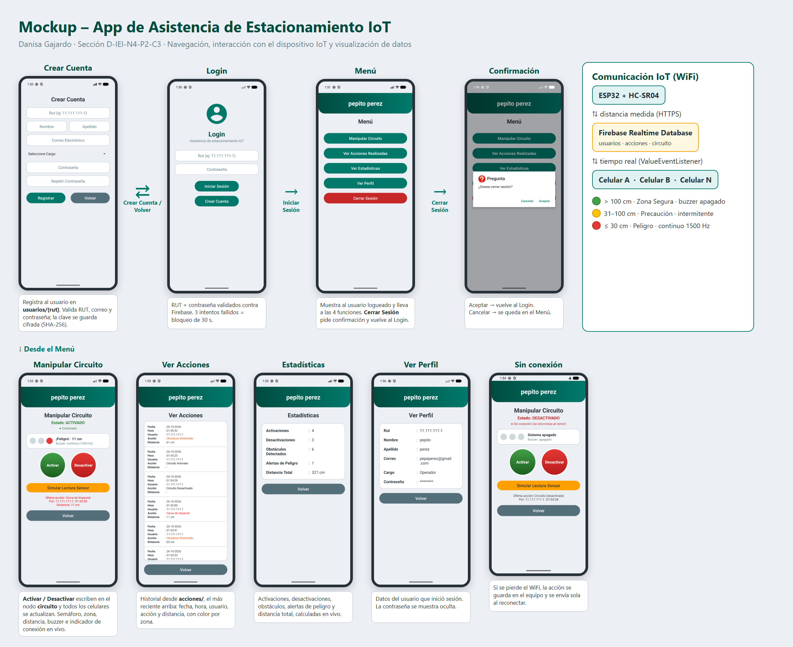

# App1_Firebase – Asistencia de Estacionamiento IoT

Aplicación Android (Kotlin) para **controlar y monitorear de forma remota un sistema IoT de asistencia de
estacionamiento** (ESP32 + sensor ultrasónico HC-SR04 + semáforo LED + buzzer) desde **dos o más celulares a la vez**,
usando **Firebase Realtime Database** por WiFi / datos móviles.



## 1. Problemática

En entornos urbanos y recintos privados, las maniobras de estacionamiento presentan dificultades por el cálculo
impreciso de distancias y la falta de visibilidad periférica, lo que aumenta el riesgo de colisiones leves con
obstáculos o paredes. En la Unidad 1 se construyó un prototipo que mide la distancia con un sensor ultrasónico y
avisa al conductor con un semáforo LED, un buzzer y una pantalla LCD.

Ese prototipo solo entrega la información **en el lugar**. La aplicación móvil permite que **varias personas**
(conductor, guardia, administrador del estacionamiento) **activen o desactiven el sistema y vean la distancia y la
zona de riesgo en tiempo real desde sus celulares**, dejando un historial de quién hizo cada acción. Además, cubre la
falla de visualización del LCD detectada en el montaje físico, ya que la distancia también se ve en la app.

### Dispositivos y sistemas a conectar

| Dispositivo / sistema | Función |
|---|---|
| ESP32 | Microcontrolador con WiFi integrado: mide la distancia y la envía a la nube. |
| Sensor ultrasónico HC-SR04 | Mide la distancia al obstáculo (Trig GPIO 14, Echo GPIO 33). |
| Semáforo LED (verde, amarillo, rojo) | Indica la zona de riesgo en la maqueta (GPIO 25, 26, 27). |
| Buzzer piezoeléctrico | Alerta sonora intermitente o continua según la zona (GPIO 32). |
| Firebase Realtime Database | Punto central en la nube donde se guardan y sincronizan los datos. |
| Celulares Android (2 o más) | Controlan el sistema y muestran la información en tiempo real. |

### Zonas de riesgo (mismas reglas del firmware de la Unidad 1)

| Distancia | Zona | Semáforo | Buzzer | Registro en la app |
|---|---|---|---|---|
| Más de 100 cm | Segura | Verde | Apagado | Zona Segura |
| 31 a 100 cm | Precaución | Amarillo | Intermitente | Obstáculo Detectado |
| 30 cm o menos | Peligro | Rojo | Continuo (1500 Hz) | Cerca de Impactar |

## 2. Funcionalidades

| Pantalla | Funcionalidad |
|---|---|
| Login | Inicio de sesión con RUT y contraseña validados contra Firebase. |
| Crear Cuenta | Registro de usuario (RUT, nombre, apellido, correo, cargo, contraseña). |
| Menú | Muestra el nombre del usuario y redirecciona a cada función. |
| Manipular Circuito | Activar / Desactivar el sistema, ver el semáforo, la zona, la distancia y el estado del buzzer en tiempo real, e indicador de conexión. Incluye un botón para simular la lectura del sensor. |
| Ver Acciones | Historial con fecha, hora, usuario, acción y distancia (colores por zona). |
| Estadísticas | Activaciones, desactivaciones, obstáculos detectados, alertas de peligro y distancia total. |
| Ver Perfil | Datos del usuario que inició sesión (contraseña oculta). |

## 3. Herramientas de desarrollo (justificación)

| Herramienta | Motivo |
|---|---|
| **Android Studio** | IDE oficial de Google para Android: emuladores, diseño de pantallas y depuración. |
| **Kotlin** | Lenguaje oficial recomendado por Google para Android. |
| **Gradle (Kotlin DSL) + catálogo de versiones** | Compilación estándar; las versiones de librerías se centralizan en `gradle/libs.versions.toml`. |
| **AndroidX + Material Design 3** | Componentes estándar, compatibles con distintas versiones de Android. |
| **Firebase Realtime Database** | Almacenamiento en la nube con sincronización en tiempo real entre dispositivos. |
| **Firebase Authentication (sesión anónima)** | Permite que las reglas de seguridad exijan una sesión válida en cada lectura y escritura. |
| **JUnit** | Pruebas automáticas de la lógica de seguridad y de las zonas. |
| **GitHub** | Control de versiones del código. |

Estructura: una Activity por pantalla, con la lógica en el `.kt` y el diseño en el `.xml`. Versión mínima: Android 13 (API 33).

### Almacenamiento: por qué Firebase

| Opción | Ventaja | Limitación para este proyecto | Decisión |
|---|---|---|---|
| SQLite (local) | Funciona sin Internet. | Los datos quedan en un solo celular: no se pueden compartir entre dispositivos. | No |
| API + MySQL | Control total del servidor. | Requiere programar y mantener un backend propio. | No |
| **Firebase Realtime Database** | Datos compartidos y sincronizados en tiempo real, sin servidor propio, con modo sin conexión. | Depende de un servicio externo. | **Sí** |

**Interoperabilidad con los sensores:** los datos se guardan en formato JSON y se acceden por HTTPS. El ESP32 puede
escribir la distancia medida en el nodo `circuito` usando la librería de Firebase para ESP32; la app calcula la zona a
partir de esa distancia con las mismas reglas del firmware, por lo que el ESP32 solo necesita enviar el valor medido.
En esta etapa la lectura se simula desde la app con el botón **Simular Lectura Sensor**.

### Sistema de login: por qué usuarios en Firebase con RUT

| Criterio | Justificación |
|---|---|
| Seguridad | La contraseña se guarda como hash SHA-256; las reglas exigen sesión y no permiten sobrescribir cuentas; la comunicación es solo HTTPS. |
| Escalabilidad | Los usuarios están en la nube: cualquier celular puede iniciar sesión con la misma cuenta, y Firebase escala sin configurar servidores. |
| Facilidad de implementación | Se integra con la misma base de datos del sistema, sin backend adicional. |

Se usa el **RUT** como identificador porque es el dato con que se registra al personal en Chile. Una mejora futura
es migrar a Firebase Authentication con correo y contraseña.

## 4. Comunicación inalámbrica

| Criterio | Bluetooth (BLE) | **WiFi + Firebase** | MQTT (sobre WiFi) |
|---|---|---|---|
| Distancia | ~10 m | Ilimitada (vía Internet) | Ilimitada (vía Internet) |
| Consumo de energía | Muy bajo | Medio | Bajo |
| Estabilidad | Se corta al alejarse; pocos dispositivos a la vez | Reconexión automática y modo sin conexión | Buena, pero requiere un broker propio |
| Varios celulares a la vez | Limitado | Sí | Sí |
| Historial de datos | No | Sí (base de datos) | No (requiere almacenamiento aparte) |

**Elección: WiFi con Firebase.** El estacionamiento necesita que personas en distintos lugares vean el estado al
mismo tiempo, algo que Bluetooth no permite por su alcance. MQTT consume menos energía, pero obliga a instalar y
mantener un broker y no guarda historial. El ESP32 tiene WiFi integrado y se alimenta por USB en la maqueta, por lo que
el consumo no es una limitante. Si un celular pierde la conexión, las acciones se guardan en el equipo y se envían
al reconectar.

**Permisos usados:** `INTERNET` (comunicación con Firebase) y `ACCESS_NETWORK_STATE` (estado de la red).

### Estructura de la base de datos

```
usuarios/{rut}   rut, nombre, apellido, correo, cargo, contrasena (hash)
acciones/{id}    fecha, hora, usuario, accion, distancia, timestamp
circuito         estado, usuario, fecha, hora, ultimaAccion, ultimaDistancia
```

## 5. Seguridad (ISO/IEC 27400 – IoT)

| Práctica | Implementación |
|---|---|
| Cifrado de credenciales | La contraseña se guarda como hash SHA-256 de RUT + contraseña + clave fija, nunca en texto plano. |
| Control de acceso | Login con RUT y contraseña; bloqueo de 30 segundos tras 3 intentos fallidos; reglas de Firebase que exigen sesión. |
| Integridad de datos | Una cuenta no se puede sobrescribir y el historial no se puede modificar ni borrar. |
| Conexiones seguras | `usesCleartextTraffic="false"`: solo HTTPS/TLS. |
| Protección de datos sensibles | `allowBackup="false"`, pantallas internas con `exported="false"` y contraseña oculta en el perfil. |
| Validación de entradas | RUT con dígito verificador, correo válido y contraseña de mínimo 6 caracteres con letras y números. |

**Brechas de la Unidad 1 que cubre la app:** la Unidad 1 identificó que habilitar WiFi en el ESP32 sin cifrado ni
control de acceso expondría el sistema. La app y la base de datos usan solo HTTPS, exigen sesión para leer o escribir y
registran quién realiza cada acción.

## 6. Pruebas

**Pruebas automáticas (JUnit)** en `app/src/test`: validación de RUT, hash de contraseñas, reglas de contraseña y
clasificación de zonas. Se ejecutan en Android Studio con clic derecho sobre la carpeta `test` → *Run Tests*.
Resultado: 12 de 12 pruebas aprobadas.

**Pruebas de reglas de Firebase:** intentos de leer o escribir sin sesión, borrar el historial, modificar acciones,
sobrescribir cuentas, guardar contraseñas en texto plano y conectarse por HTTP: todos rechazados.

**Errores detectados y corregidos**

| Error | Corrección |
|---|---|
| La app no compilaba: Firebase Auth 25 requiere Kotlin 2.3 o superior y el proyecto usaba 2.2. | Se actualizó Kotlin a 2.4.0. |
| El texto "Desactivar" se cortaba en dos líneas dentro del botón circular. | Se reorganizaron los botones uno al lado del otro y se ajustó el tamaño del texto. |
| El texto blanco del botón del sensor no se leía sobre el fondo ámbar. | Se cambió a texto oscuro. |
| Los umbrales de alerta de la app (10 cm) no coincidían con el firmware de la Unidad 1. | Se igualaron a 100 cm y 30 cm. |

## 7. Cómo ejecutar

1. Abrir el proyecto en Android Studio y sincronizar Gradle.
2. Ejecutar en 2 emuladores o celulares con Internet.

## Autora

Danisa Gajardo – Sección D-IEI-N4-P2-C3, INACAP.
